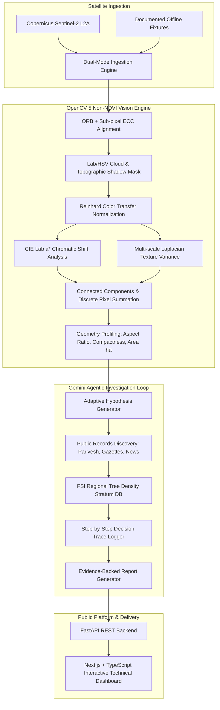

# Forest Guard: Technical Report & Submission Blueprint
**OpenCV AI Competition 2026 — Agentic Vision Special Award**

## 1. Problem Statement & User Needs
Deforestation and unauthorized land-use conversion in ecologically sensitive ecosystems—such as India's Western Ghats (a UNESCO World Heritage biodiversity hotspot)—frequently outpace manual administrative field enforcement. Existing global alert tools provide low-resolution pixel flags but fail to establish why changes occurred, what infrastructure or commercial projects are linked, or whether regulatory clearances exist.

Forest Guard automates both detection and investigative research, bridging computer vision and regulatory records to deliver verified, actionable reports for conservationists, park wardens, and investigative journalists.

---

## 2. System Architecture



---

## 3. Substantive OpenCV 5 Vision Implementation
- **Zero Vegetation Index Constraint:** Explicitly excludes NDVI, ExG, and all spectral band ratios.
- **Color Metric:** Direct CIE Lab color-space difference ($a^*$ green-red chromaticity shift) capturing canopy-to-soil conversion ($\Delta a^* > 0$) vs. afforestation recovery ($\Delta a^* < 0$).
- **Structural Textural Variance:** Laplacian operator ($k=3$) with spatial box filtering measuring high-frequency crown roughness loss.
- **Raster Quantification:** Connected component analysis (`connectedComponentsWithStats`) summing exact ground pixels ($1\text{ px} = 100\text{ m}^2 = 0.01\text{ ha}$ at 10m resolution).

---

## 4. Closed-Loop Agentic Research & Evidence Integrity
- OpenCV 5 geometric profiling directly steers search actions:
  - `linear_corridor` ($\text{Aspect} \ge 3.0$) -> Directs queries to infrastructure, roadway widening, and MoEFCC clearance portals.
  - `compact_block` -> Directs queries to commercial clearcutting, agricultural land diversion, and timber monitoring.
  - `forest_recovery_candidate` -> Directs queries to state compensatory afforestation schemes.
- **Evidence Integrity Tiers:** Distinguishes `primary_official_record`, `credible_news_report`, `scientific_assessment`, and `simulated_test_record`.
- **Tree Density Bounds:** Uses verified Forest Survey of India (FSI) State of Forest Report baselines (240–450 stems/ha with $\text{DBH} \ge 10\text{ cm}$) to calculate impact ranges.

---

## 5. AWS Deployment Architecture & Realistic Cost Analysis

### Economical Serverless vs. Container Trade-off Comparison
To satisfy the competition deployment requirement in region `ap-south-1` (Mumbai):

| Component | Architecture Option A: Fully Serverless (Recommended) | Architecture Option B: Container (ECS Fargate) |
| :--- | :--- | :--- |
| **Frontend** | AWS S3 Static Website + CloudFront CDN | AWS S3 Static Website + CloudFront CDN |
| **Backend API** | AWS Lambda (Container Image) + HTTP API Gateway | ECS Fargate 0.25 vCPU / 0.5 GB RAM + ALB |
| **Data Storage** | S3 Bucket (JSON reports + PNG crops) | EFS volume / S3 Bucket |
| **Idle Cost** | **$0.00 / month** | **~$18.00 / month** (ALB + continuous Fargate) |
| **Monthly Estimate** | **$0.01 – $0.50 / month (AWS)** | **$18.50 – $22.00 / month (AWS)** |

### Table A: Verified AWS Infrastructure Costs (`ap-south-1` Mumbai)
AWS Lambda provides an **always-free allowance of 400,000 GB-seconds and 1,000,000 requests per month**. Below is an itemized breakdown based on 10,000 API requests/month (512 MB memory, 1.5s duration = 7,500 GB-s) and 5 scheduled monitoring invocations/month (1024 MB memory, 60s duration = 300 GB-s).

| AWS Service & Operational Driver | AWS Free Tier Allowance | Monthly Cost With Free Tier | Standard Cost Without Free Tier (`ap-south-1`) |
| :--- | :--- | :--- | :--- |
| **AWS Lambda (Compute)** | 400,000 GB-s / month (Always Free) | **$0.00** (7,800 GB-s used) | $0.130 (7,800 GB-s @ $0.0000166667) |
| **AWS Lambda (Requests)** | 1,000,000 requests / month (Always Free) | **$0.00** (10,005 requests used) | $0.002 (10,005 reqs @ $0.20/1M) |
| **Amazon API Gateway (HTTP API v2)** | None | **$0.010** (10,000 calls @ $1.00/1M) | $0.010 (10,000 calls @ $1.00/1M) |
| **Amazon S3 (Standard Storage)** | 5 GB storage, 20k GET, 2k PUT (12 mo) | **$0.00** (0.5 GB reports/imagery) | $0.020 (0.5 GB @ $0.025 + GET/PUT ops) |
| **Amazon CloudFront (CDN)** | 1 TB egress, 10M HTTPS reqs (Always Free) | **$0.00** (2 GB egress, 10k reqs) | $0.230 ($0.109/GB egress + HTTPS fee) |
| **Amazon ECR (Container Registry)** | 500 MB / month storage (Always Free) | **$0.00** (~450 MB stripped image) | $0.045 (0.45 GB @ $0.10/GB) |
| **Amazon EventBridge (Scheduler)** | Recurring schedule rules are $0.00 | **$0.00** (Always Free) | $0.000 (No charge for scheduled rules) |
| **Amazon CloudWatch (Logs)** | 5 GB log ingestion & storage (Always Free) | **$0.00** (~100 MB logs/month) | $0.067 (0.1 GB @ $0.67/GB ingestion) |
| **SUBTOTAL (AWS INFRASTRUCTURE)** | — | **~$0.010 / month** | **~$0.504 / month** |

### Table B: External API & Model Costs (Google Gemini & Tavily)
Based on ~20 incident investigations/month (~100,000 input tokens, ~20,000 output tokens, ~60 search queries/month):

| External Provider | Applicable Free Tier Terms | Cost With Free Tier | Standard Paid Rate Without Free Tier |
| :--- | :--- | :--- | :--- |
| **Google Gemini (`gemini-2.5-flash`)** | Free up to 15 RPM, 1M TPM, 1,500 RPD on Google AI Studio | **$0.00** (~20 invocations/month) | $0.080 (100k input @ $0.30/1M + 20k output @ $2.50/1M) |
| **Tavily Search API** | 1,000 search credits / month (Always Free) | **$0.00** (~60 queries/month) | $0.300 (60 queries @ $0.005/query) |
| **SUBTOTAL (EXTERNAL MODEL & SEARCH)** | — | **$0.00 / month** | **~$0.380 / month** |

**COMBINED GRAND TOTAL (AWS + External APIs):**
- **With Free Tier Allowances:** **~$0.010 / month** (HTTP API Gateway charges only).
- **Without Free Tier Allowances (Full Standard Commercial Pricing):** **~$0.884 / month** ($0.504 AWS + $0.380 External).
- *Both scenarios comfortably operate within the project constraint (<$5.00/month).*

*Both operational models comfortably satisfy the low-cost constraint (<$5.00/month) with zero idle overhead.*

### Deployment Sequence & Cleanup Protocol
1. **Prerequisite:** Docker daemon running, AWS CLI configured with `ap-south-1` profile.
2. **Step 1 — Build and Push Container Image to ECR:**
   ```bash
   aws ecr create-repository --repository-name forestguard-backend --region ap-south-1
   aws ecr get-login-password --region ap-south-1 | docker login --username AWS --password-stdin <account_id>.dkr.ecr.ap-south-1.amazonaws.com
   docker build -f Dockerfile.lambda -t forestguard-backend:latest .
   docker tag forestguard-backend:latest <account_id>.dkr.ecr.ap-south-1.amazonaws.com/forestguard-backend:latest
   docker push <account_id>.dkr.ecr.ap-south-1.amazonaws.com/forestguard-backend:latest
   ```
3. **Step 2 — Deploy Serverless Stack via CloudFormation:**
   ```bash
   aws cloudformation deploy \
     --template-file aws/cloudformation.yaml \
     --stack-name forestguard-production \
     --parameter-overrides ECRImageUri=<account_id>.dkr.ecr.ap-south-1.amazonaws.com/forestguard-backend:latest \
     --capabilities CAPABILITY_IAM \
     --region ap-south-1
   ```
4. **Step 3 — Build and Sync Frontend:**
   ```bash
   API_URL=$(aws cloudformation describe-stacks --stack-name forestguard-production --query "Stacks[0].Outputs[?OutputKey=='BackendApiEndpoint'].OutputValue" --output text --region ap-south-1)
   cd web && NEXT_PUBLIC_API_URL=$API_URL npm run build
   FRONTEND_BUCKET=$(aws cloudformation describe-stacks --stack-name forestguard-production --query "Stacks[0].Outputs[?OutputKey=='FrontendBucketName'].OutputValue" --output text --region ap-south-1)
   aws s3 sync out/ s3://$FRONTEND_BUCKET --delete --region ap-south-1
   ```
5. **Teardown & Safe Resource Deletion:**
   ```bash
   # Empty versioned S3 buckets first, then delete CloudFormation stack
   aws s3 rm s3://$FRONTEND_BUCKET --recursive --region ap-south-1
   REPORT_BUCKET=$(aws cloudformation describe-stacks --stack-name forestguard-production --query "Stacks[0].Outputs[?OutputKey=='ReportStorageBucketName'].OutputValue" --output text --region ap-south-1)
   aws s3 rm s3://$REPORT_BUCKET --recursive --region ap-south-1
   aws cloudformation delete-stack --stack-name forestguard-production --region ap-south-1
   aws ecr delete-repository --repository-name forestguard-backend --force --region ap-south-1
   ```

---

## 6. Demonstration Video Plan (5-Minute Structure)
1. **Minute 1: Introduction & Mission:** Overview of Forest Guard, OpenCV AI Competition 2026 challenge, and Maharashtra Western Ghats ecological context.
2. **Minute 2: OpenCV 5 Vision Pipeline:** Live execution of the non-NDVI detector showing sub-pixel ECC registration, cloud/shadow exclusion, CIE Lab chromatic shift, and exact raster pixel measurement.
3. **Minute 3: Negative Control Suppression:** Demonstrating Mahabaleshwar seasonal leaf-drop and cloud shadow being rejected (`0.0 ha` change detected; zero false alarms).
4. **Minute 4: Autonomous Gemini Investigation:** Real-time demonstration showing linear corridor geometry driving targeted infrastructure queries, FSI tree-count calculation, and full audit trace logging.
5. **Minute 5: Technical Web Dashboard & AWS Architecture:** Walkthrough of the responsive map, before/after satellite slider, citation inspector, and low-cost serverless deployment architecture.
